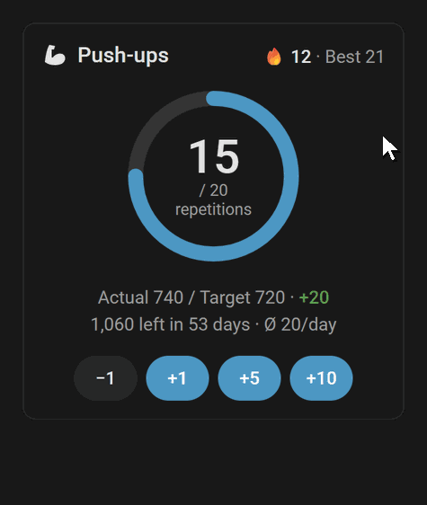
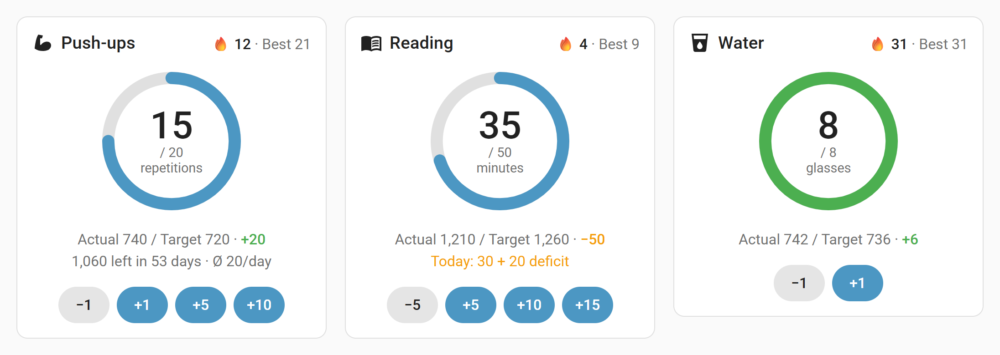

# Changelog

All notable changes to this project are documented here. The format follows
[Keep a Changelog](https://keepachangelog.com/en/1.1.0/), and the project uses
[Semantic Versioning](https://semver.org/). Before 1.0, minor releases may contain
breaking changes; they are marked as **Breaking**.

Each version starts with its highlight and ends with the Home Assistant release it was
tested with. The section of a version is also the text of its GitHub release, which HACS
and Home Assistant show when they offer the update.

## [Unreleased]

## [0.2.0] - 2026-11-07

> **Highlight:** see your days in a calendar and correct them there, let a sensor count
> for you, celebrate milestones, talk to your challenges with Assist and see them all on
> one card.

### ✨ Added

- **Automatic counting:** a challenge can take today's value from a sensor such as
  "steps today", or add every increase of a counter that keeps rising, such as an
  odometer. Set it under *Automatic counting* in the options.
- **Milestones:** a new *Milestone* event per challenge fires for streak milestones
  (7, 14, 30 … days), a new best streak, a new best day and total milestones (100, 250,
  500 …). Choose the kinds in the options. A new blueprint congratulates you.
- **Assist:** AI assistants can add to, set and read your challenges once their *Today*
  entity is exposed; a new blueprint adds sentences for the built-in Assist.
- **Overview card** `custom:daily-challenge-overview-card` with all challenges at a
  glance and a **+** button each.
- **Calendar (heatmap)** in the card: one square per day for the last year, 6 or 3
  months, coloured by how close the day came to its target. Tap a day to correct its
  value, with undo.
- **Statistics row** in the card: total, average per day, best day and best streak.
- The history (`get_history` and the card) lists yesterday under `rescuable` while it
  can still be made up in catch-up mode.
- **Celebration** in the card: confetti when today's goal is reached and for every
  milestone, with a short text such as "7 days in a row!". Switch it off with
  `show_celebration: false`; with reduced motion only the text is shown.
- **Device triggers** "Today's goal reached", "Milestone reached" and one per kind of
  milestone, right in the automation editor.
- **Quick add blueprint:** a button press or a scanned NFC tag adds an amount.
- **Weekly summary blueprint:** on a chosen day, a message with the week's total,
  fulfilled days and streak.
- New action `daily_challenge.get_status` with today's figures and the sums of this
  week, month and year, independent of the language of the entity IDs.

### 🔄 Changed

- The data of a challenge gets a new field for the counter source; existing data is
  migrated automatically.

*Tested with Home Assistant 2026.10.2 and 2026.11.0 · minimum 2026.10.0*

## [0.1.2] - 2026-11-02

> **Highlight:** Daily Challenge is in the HACS default store, and big numbers now fit
> the card.

### 🔄 Changed

- Daily Challenge is in the HACS default store: search for it in HACS, no custom
  repository needed.

### 🐛 Fixed

- Long figures such as 100,000 or a total in the millions shrink to stay inside the
  card's ring, and a long unit is cut off with "…" instead of leaving it.
- Undo takes back only what a button really added when the day hit its upper limit of
  100,000.

*Tested with Home Assistant 2026.10.2 · minimum 2026.10.0*

## [0.1.1] - 2026-10-25

> **Highlight:** undo for every tap, and a summary once a challenge has ended.

### ✨ Added

- **Undo** in the card: every button press and typed value is followed by a message with
  an *Undo* button (8 seconds).
- **Finished challenges** show the total against the end goal in the card, e.g.
  *Challenge finished · 90 %* or *goal reached ✓*, instead of an empty day.
- In catch-up mode the card says **Deficit made up ✓** once today's goal including
  yesterday's deficit is reached.

### 🔄 Changed

- Today's value and the buttons are unavailable before the start and after the end date
  instead of rejecting input with an error. Past days stay editable through the actions.

### 🐛 Fixed

- Setting today's value to a fraction (e.g. 12.5) is rejected instead of cut off, and
  actions no longer accept `true`/`false` as a number.

*Tested with Home Assistant 2026.10.2 · minimum 2026.10.0*

## [0.1.0] - 2026-10-25

> **Highlight:** the first public beta – daily goals with streaks, catch-up mode and its
> own card.

### ✨ Added

- **One device per challenge**, set up and changed in the UI: name, icon, unit, daily
  target, start and optional end date, up to three steps, streak rule (daily target
  reached or any amount) and deficit handling (show only or catch up). A new daily target
  applies from the day of the change; past days keep theirs.
- **Entities:** today's value, add and subtract buttons, today's target, progress, total,
  current and best streak, target to date, ahead/behind, remaining until the end goal,
  days left and required average per day (with an end date), daily average, best day,
  weekly, monthly and yearly sums and "goal reached today".
- **Catch-up mode:** yesterday's deficit raises today's target, and a missed day can be
  made up on the following day without breaking the streak – only the previous day, no
  working ahead.
- **Card** `custom:daily-challenge-card`, installed and registered automatically: progress
  ring, quick buttons, direct input by long press, streaks, target vs. actual, what is
  left with days left and required average, catch-up deficit, and a visual editor with a
  switch for each part.
- **Actions** `daily_challenge.add`, `daily_challenge.set` and
  `daily_challenge.get_history`, with translated validation errors.
- **Reminder blueprint:** a notification at a chosen time while today's goal is still
  open.
- Day rollover at local midnight without resetting anything, robust against restarts and
  daylight saving time; diagnostics; WebSocket commands for the card.
- English, German, French and Italian (French and Italian open for community review).

*Tested with Home Assistant 2026.10.2 · minimum 2026.10.0*

[Unreleased]: https://github.com/Skylolerr/ha-daily-challenge/compare/v0.2.0...HEAD
[0.2.0]: https://github.com/Skylolerr/ha-daily-challenge/compare/v0.1.2...v0.2.0
[0.1.2]: https://github.com/Skylolerr/ha-daily-challenge/compare/v0.1.1...v0.1.2
[0.1.1]: https://github.com/Skylolerr/ha-daily-challenge/compare/v0.1.0...v0.1.1
[0.1.0]: https://github.com/Skylolerr/ha-daily-challenge/releases/tag/v0.1.0
