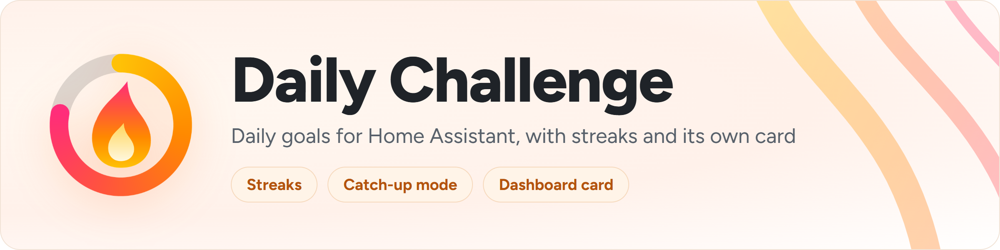
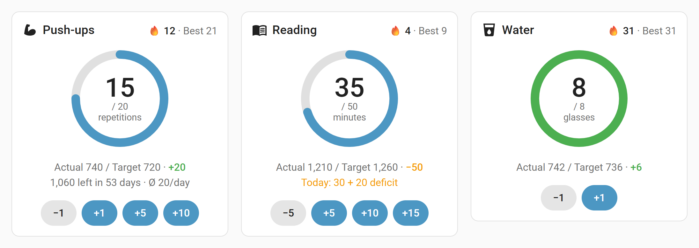
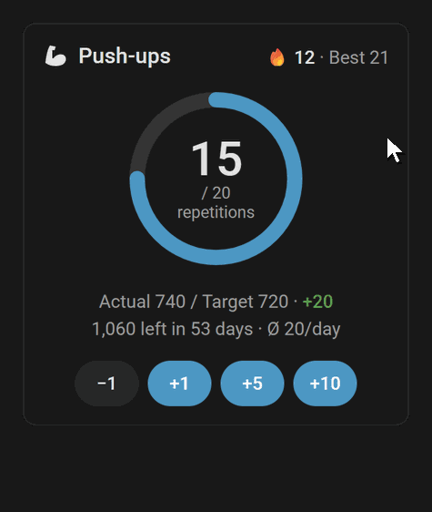
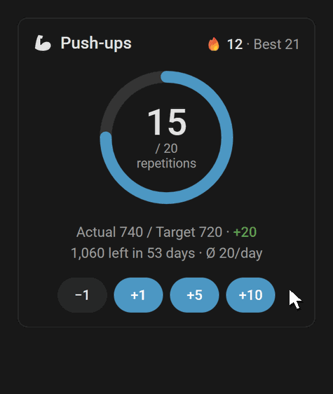
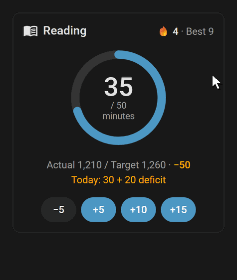
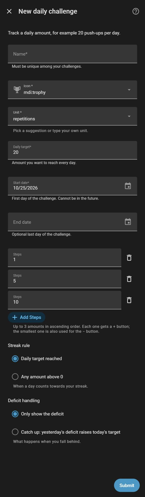
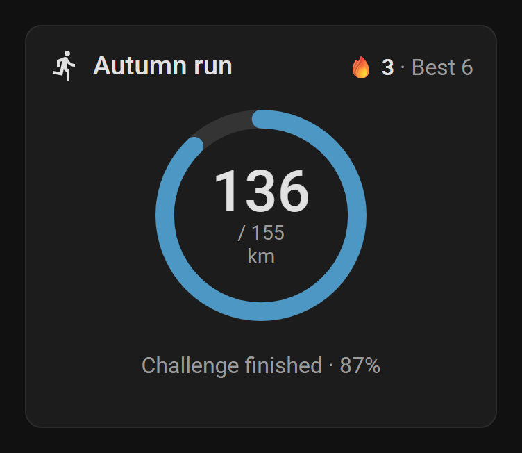

<p align="center">
  <picture>
    <source media="(prefers-color-scheme: dark)" srcset="https://raw.githubusercontent.com/Skylolerr/ha-daily-challenge/main/docs/images/banner-dark.png">
    
  </picture>
</p>

<p align="center">
  <a href="https://hacs.xyz"></a>
  <a href="https://github.com/Skylolerr/ha-daily-challenge/releases/latest"></a>
  
  <a href="https://github.com/Skylolerr/ha-daily-challenge/actions/workflows/validate.yml"></a>
  <a href="https://github.com/Skylolerr/ha-daily-challenge/actions/workflows/tests.yml"></a>
  <a href="LICENSE"></a>
</p>

<p align="center">
  <a href="https://my.home-assistant.io/redirect/hacs_repository/?owner=Skylolerr&repository=ha-daily-challenge&category=integration"></a>
  <a href="https://my.home-assistant.io/redirect/config_flow_start/?domain=daily_challenge"></a>
</p>

**A goal-based daily challenge tracker, not just a counter.** Daily Challenge tracks
amounts you want to reach every day – "20 push-ups", "30 minutes of reading",
"10,000 steps" – with streaks, target vs. actual over the whole challenge, an optional
catch-up mode, milestones and its own dashboard cards. Count by hand, or let a sensor such
as your step counter count for you.

> [!NOTE]
> **Beta.** Breaking changes are possible before 1.0. They are always listed in the
> [changelog](CHANGELOG.md), and your recorded data is migrated, never dropped.

<p align="center">
  <picture>
    <source media="(prefers-color-scheme: dark)" srcset="https://raw.githubusercontent.com/Skylolerr/ha-daily-challenge/main/docs/images/hero-dark.png">
    
  </picture>
</p>

## See it in action

<table>
  <tr>
    <td width="33%"></td>
    <td width="33%"></td>
    <td width="33%"></td>
  </tr>
  <tr>
    <td><b>One tap, with undo.</b> Quick buttons for your steps; every change can be taken back from the message that follows.</td>
    <td><b>Type a value.</b> A long press on today's value opens an input – handy after a workout without the phone.</td>
    <td><b>Catch up.</b> Yesterday's deficit raises today's target; make it up and your streak survives.</td>
  </tr>
</table>

## Features

**Track your goal**

- **A daily amount, not a yes/no habit** – each challenge has its own daily target, unit
  and buttons.
- **Target vs. actual over the whole runtime** – ahead or behind at a glance and, with an
  end date, what is left, in how many days and the average still needed per day.
- **Correct any past day** right in the card's calendar, or with the actions.
- **Automatic counting** – take today's value from a sensor (e.g. "steps today"), or add
  every increase of a counter that keeps rising (e.g. an odometer).

**Stay motivated**

- **Streaks** with a choice of rule (daily target reached, or any amount), plus best
  streak, best day, daily average and weekly, monthly and yearly sums.
- **Optional catch-up mode** – yesterday's deficit raises today's target, so a missed day
  can be made up on the following day without breaking the streak.
- **Milestones** – an event when the streak reaches 7, 14, 30 … days, for a new best
  streak, a new best day or a total of 100, 250, 500 …, with a blueprint that
  congratulates you. You choose which kinds count.
- **Reminder blueprint** – a notification at 20:00 while today's goal is still open.
- **Confetti** in the card when today's goal or a milestone is reached, and a **weekly
  summary** blueprint.

**Fits into Home Assistant**

- **Its own card** with a progress ring, quick buttons, undo, streak and target vs.
  actual, and a visual editor – installed and registered automatically.
- **An overview card** with all challenges at a glance, one row each.
- **Quick add with a button or NFC tag**, and **device triggers** for today's goal and
  milestones in the automation editor.
- **Assist** – "Add 20 to push-ups" or "How many push-ups today?" by voice or chat: AI
  assistants get tools for it, and a blueprint adds the sentences for the built-in Assist.
- **Plain entities** that work just as well with Tile, Entities, Mushroom or ApexCharts.
- **English, German, French and Italian**, light and dark theme, your number format.

## Installation

1. **HACS:** open HACS, search for **Daily Challenge** and download it, or click *Open
   this repository in HACS* above. Then restart Home Assistant.
2. **Set up:** click *Set up Daily Challenge* above, or Settings → Devices & services →
   **Add integration** → **Daily Challenge**. Each challenge is its own entry; add the
   integration again for another challenge.
3. **Add the card:** *Edit dashboard* → *Add card* → **Daily Challenge**.

Requires Home Assistant **2026.10.0** or newer.

<details>
<summary>Manual installation</summary>

Download `daily_challenge.zip` from the
[latest release](https://github.com/Skylolerr/ha-daily-challenge/releases/latest),
extract it to `config/custom_components/daily_challenge/` and restart Home Assistant.
</details>

### Options

Set when you add a challenge; all of them can be changed later via **Configure**.

| Option | Default | Meaning |
|---|---|---|
| Name | – | Unique name of the challenge, also the device name. |
| Icon | `mdi:trophy` | Shown in the card and on the "Today" entity. |
| Unit | repetitions | Pick a suggestion (repetitions, minutes, km, pages, glasses) or type your own. |
| Daily target | 20 | Whole number above 0. A new target applies from today on; past days keep theirs. |
| Start date | today | Cannot be in the future. Moved later, the days before it are ignored but not deleted. |
| End date | – | Optional. Enables what is left until the end goal, days left and the required average per day. |
| Steps | 1, 5, 10 | Up to 3 amounts in ascending order. Each gets a **+** button; the smallest one is also used for **−**. |
| Streak rule | Daily target reached | When a day counts towards the streak: *daily target reached* or *any amount above 0*. |
| Deficit handling | Only show the deficit | *Only show the deficit*, or *Catch up*: yesterday's deficit raises today's target. |
| Automatic counting → Source | – | Optional sensor, number, input number or counter that feeds the challenge. |
| Automatic counting → Source type | Daily value | *Daily value*: the source shows today's amount (e.g. steps today) and sets it; the buttons are not available then. *Counter*: the source keeps rising (e.g. an odometer) and every increase is added; the buttons stay. |
| Milestones | all | Which milestones fire the milestone event: streak milestones, new best streak, new best day, total milestones. None: no milestone event. |

**Automatic counting** only counts while the challenge runs and rounds to whole numbers
(2.5 becomes 3).
With a *daily value* source, today's value always follows the sensor; past days stay
editable through the actions. Only a reading that changed today counts, so a step counter
that still shows yesterday's steps for a few minutes after midnight does not carry them
over – also not after a restart, when a source restores yesterday's amount. With a *counter*, fractions are carried over (3 × 0.4 km
make 1 km). After a drop of more than 10 % the next reading decides: back near the old
reading, it was a glitch (e.g. 0 while a device restarts) and only the rise counts;
if it rises from the low reading, the counter was reset and counts from 0. What was added
while Home Assistant was off counts on the day it sees it again. Changing the source or
its type starts the counter afresh.

<details>
<summary>The setup form</summary>

<p align="center">
  
</p>
</details>

## Card

The card comes with the integration and is registered as a dashboard resource
automatically. Add it in the dashboard editor (*Add card* → **Daily Challenge**) or in
YAML:

```yaml
type: custom:daily-challenge-card
entity: number.push_ups_today   # any entity of the challenge
show_streak: true               # current and best streak in the header
show_target_vs_actual: true     # actual vs. target with ahead/behind
show_remaining: true            # what is left until the end goal, in how many days
show_required_average: true     # the average still needed per day
show_catch_up: true             # the deficit in today's target in catch-up mode
show_buttons: true              # the − and + buttons
show_stats: true                # total, Ø per day, best day and best streak
show_heatmap: true              # the calendar of daily values
heatmap_range: year             # year | 6months | 3months
show_celebration: true          # confetti for today's goal and for milestones
```

All parts are shown by default; the visual editor has a switch for each and a choice of
the calendar range. Today's value and the progress ring are always shown.

| To … | Do this |
|---|---|
| Add a step | Tap **+5** (or another step) |
| Take back the last change | Tap **Undo** in the message that follows (8 seconds) |
| Type today's value | Long press (or Enter) on the value, type, Enter |
| See yesterday's deficit | In catch-up mode the card shows *Today: 20 + 10 deficit*, then *Deficit made up ✓* |
| See how a finished challenge went | After the end date the card shows the total against the end goal |
| See your history | The calendar shows one square per day, weeks as columns and Monday on top: green when the day counts towards the streak, blue when it does not (stronger the closer to the target), a dashed orange outline for yesterday while it can still be made up, grey outside the challenge. Today has an outline. |
| Correct a past day | Tap its square in the calendar, change the value, **Save** (with **Undo** afterwards) |

<p align="center">
  
</p>

The card follows your theme, language and number format.

### Overview card

All challenges at a glance, one row each with today's value, the target, a progress bar,
the streak and a **+** button for the smallest step. Tap a row for the details. Add it as
**Daily Challenge overview** or in YAML:

```yaml
type: custom:daily-challenge-overview-card
title: My challenges            # optional
entities:                       # optional, the "Today" entities; empty shows all
  - number.push_ups_today
  - number.steps_today
show_buttons: true              # the + button of the smallest step
```

## Entities

One device per challenge with these entities (example IDs for a challenge named
"Push-ups"). Home Assistant creates the entity IDs in its system language, so with German
they look like `number.push_ups_heute` or `sensor.push_ups_notig_pro_tag`.

| Entity | Example ID | Description |
|---|---|---|
| Today | `number.push_ups_today` | Today's value, directly settable (not with a *daily value* source). Unavailable before the start and after the end date. |
| +n / −n | `button.push_ups_add_5`, `button.push_ups_subtract` | Add a step or subtract the smallest step (never below 0). |
| Today's target | `sensor.push_ups_today_s_target` | Effective target of today. Attributes `daily_target` and `deficit`. |
| Progress | `sensor.push_ups_progress` | Today's progress in % (up to 999 %). |
| Total | `sensor.push_ups_total` | Sum since the start. |
| Current streak | `sensor.push_ups_current_streak` | In days. |
| Best streak | `sensor.push_ups_best_streak` | In days, attributes `start` and `end`. |
| Ahead / behind | `sensor.push_ups_ahead_behind` | Total minus target to date. |
| Remaining | `sensor.push_ups_remaining` | Left until the end goal (only with an end date). |
| Days left | `sensor.push_ups_days_left` | Days until the end date, today included (only with an end date). |
| Required per day | `sensor.push_ups_required_per_day` | Average still needed per day to reach the end goal (only with an end date). |
| Best day | `sensor.push_ups_best_day` | Highest daily value, attribute `date`. |
| Goal reached today | `binary_sensor.push_ups_goal_reached_today` | On once today's target is reached. |
| Milestone | `event.push_ups_milestone` | Fires `streak`, `best_streak`, `best_day` or `total` with the attribute `value` (see [Milestones](#milestones)). Not created without milestones. |
| Target to date, Daily average, This week, This month, This year | `sensor.push_ups_target_to_date`, … | Diagnostic sensors. Weeks start on Monday. |

The quantity sensors use the unit of the challenge; the averages use it per day.

## Actions

All actions take the challenge as `config_entry_id` (pick it in the UI). Dates must lie
between the start date (and end date) of the challenge and today.

```yaml
# Add an amount to a day; negative amounts subtract, the result never drops below 0.
action: daily_challenge.add
data:
  config_entry_id: 01J0EXAMPLE
  amount: 10
  date: "2026-11-03" # optional, defaults to today
```

```yaml
# Set the value of a day; 0 removes the entry.
action: daily_challenge.set
data:
  config_entry_id: 01J0EXAMPLE
  value: 25
  date: "2026-11-03" # optional, defaults to today
```

<details>
<summary><code>daily_challenge.get_history</code> – values, targets and streak days of a range</summary>

Returns values, targets and streak fulfilment for a date range (default: the whole
challenge up to today).

```yaml
action: daily_challenge.get_history
data:
  config_entry_id: 01J0EXAMPLE
  start: "2026-11-01" # optional
  end: "2026-11-30" # optional
response_variable: history
```

```yaml
days:
  "2026-11-01": 20
  "2026-11-03": 25
targets:
  "2026-11-01": 20
  "2026-11-02": 20
  "2026-11-03": 20
fulfilled:
  "2026-11-01": true
  "2026-11-02": false
  "2026-11-03": true
rescuable: [] # catch-up: yesterday while it can still be made up today
```
</details>

<details>
<summary><code>daily_challenge.get_status</code> – today's figures and this week's sums</summary>

Returns the current figures of a challenge, independent of the language of its entity
IDs – handy in scripts and blueprints.

```yaml
action: daily_challenge.get_status
data:
  config_entry_id: 01J0EXAMPLE
response_variable: status
```

```yaml
name: Push-ups
unit: repetitions
status: active        # not_started | active | ended
today_from_source: false  # a daily value source sets today; adding is rejected
today: 12
target: 20            # today's target, with yesterday's deficit in catch-up mode
daily_target: 20
goal_reached: false
progress: 60.0
current_streak: 3
best_streak: 8
total: 1240
this_week: 52
week_target: 60       # Monday to today
week_fulfilled_days: 2  # days that count towards the streak
week_goal_days: 2       # days that reached their target
week_days: 3
this_month: 240
this_year: 1240
remaining: null       # with an end date: what is left until the end goal
days_left: null
```
</details>

## Milestones

[](https://my.home-assistant.io/redirect/blueprint_import/?blueprint_url=https%3A%2F%2Fgithub.com%2FSkylolerr%2Fha-daily-challenge%2Fblob%2Fmain%2Fblueprints%2Fautomation%2Fdaily_challenge%2Fmilestone.yaml)

The **Milestone** event of a challenge fires when today's value makes the challenge reach
a milestone:

| Event type | When | `value` |
|---|---|---|
| `streak` | The streak reaches 7, 14, 30, 50, 100, 150, 200, 250, 300, 365, 500, 750, 1000 days, then every 500 days | Days |
| `best_streak` | The streak beats the best one of an earlier run (once per run) | Days |
| `best_day` | Today beats the best other day (once per day) | Today's value |
| `total` | The total reaches 100, 250, 500, 1000, 2500, 5000, 10,000 … | The milestone |

Only changes of today count – not recalculations at midnight or on a restart, and not
corrections of past days. A change that is undone and made again fires again. Choose the
kinds in the options of the challenge.

The blueprint congratulates you on each milestone – by default with a notification in
Home Assistant. In your own action you can use `{{ challenge }}`, `{{ kind }}`,
`{{ value }}`, `{{ unit }}` and `{{ message }}`, a ready-made sentence such as
*"7 days in a row!"*.

## Device triggers

In the automation editor, pick the challenge as device (*Add trigger → Device*) to react
to **Today's goal reached**, **Milestone reached** or one kind of milestone (*Streak
milestone reached*, *New best streak*, *New best day*, *Total milestone reached*). The
trigger offers `trigger.kind` and `trigger.value` for milestones. Kinds that are switched
off in the options of the challenge are not offered.

## Quick add with a button or NFC tag

[](https://my.home-assistant.io/redirect/blueprint_import/?blueprint_url=https%3A%2F%2Fgithub.com%2FSkylolerr%2Fha-daily-challenge%2Fblob%2Fmain%2Fblueprints%2Fautomation%2Fdaily_challenge%2Fbutton.yaml)

The blueprint adds an amount (default 1) to a challenge whenever a trigger of your
choice fires – a Zigbee or Z-Wave button, a scanned NFC tag, a smart water bottle … An
optional feedback, e.g. a short notification, can use `{{ challenge }}`, `{{ amount }}`,
`{{ done }}`, `{{ target }}` and `{{ unit }}`. While the challenge is not running or counts
by itself from a *daily value* source, a press does nothing.

## Weekly summary

[](https://my.home-assistant.io/redirect/blueprint_import/?blueprint_url=https%3A%2F%2Fgithub.com%2FSkylolerr%2Fha-daily-challenge%2Fblob%2Fmain%2Fblueprints%2Fautomation%2Fdaily_challenge%2Fweekly.yaml)

On a chosen day and time (default Sunday 20:00) the blueprint sums up the week, e.g.
*"This week: 140 of 140 repetitions, goal reached on 7 of 7 days. Streak: 12 days."* In
your own action you can use `{{ challenge }}`, `{{ done }}`, `{{ target }}`, `{{ unit }}`,
`{{ fulfilled }}` (days that reached their target), `{{ days }}`, `{{ streak }}` and
`{{ message }}`. The week runs from Monday to the day of the summary, so Sunday covers the
whole week.

## Voice commands (Assist)

**With an AI assistant** (e.g. OpenAI, Google Gemini or Anthropic Claude as conversation
agent with the Assist API): expose the challenge's **Today** entity to Assist
(*Settings → Voice assistants → Expose*). The assistant can then add to, set and read
your challenges in any language – "I just did 20 push-ups", "How am I doing with
reading?".

**With the built-in Assist**:

[](https://my.home-assistant.io/redirect/blueprint_import/?blueprint_url=https%3A%2F%2Fgithub.com%2FSkylolerr%2Fha-daily-challenge%2Fblob%2Fmain%2Fblueprints%2Fautomation%2Fdaily_challenge%2Fvoice.yaml)

The blueprint adds sentences for all challenges, such as *"Add 20 to push-ups"* and
*"How many push-ups today"*. `{challenge}` is the name of the challenge and `{amount}` a
number (digits, not words). The blueprint also answers when a challenge is not running,
when a sensor counts it by itself (it can then only be asked) and when it did not get the
amount. The sentences and answers are English by default; replace them with your
language, for example:

| Language | To add | To ask | Answer after adding |
|---|---|---|---|
| German | `füge {amount} zu {challenge} hinzu` | `wie viele {challenge} heute` | `Erledigt. {{ done }} von {{ target }} {{ unit }} heute.` |
| French | `ajoute {amount} à {challenge}` | `combien de {challenge} aujourd'hui` | `C'est fait. {{ done }} sur {{ target }} {{ unit }} aujourd'hui.` |
| Italian | `aggiungi {amount} a {challenge}` | `quanti {challenge} oggi` | `Fatto. {{ done }} su {{ target }} {{ unit }} oggi.` |

## Reminder blueprint

[](https://my.home-assistant.io/redirect/blueprint_import/?blueprint_url=https%3A%2F%2Fgithub.com%2FSkylolerr%2Fha-daily-challenge%2Fblob%2Fmain%2Fblueprints%2Fautomation%2Fdaily_challenge%2Freminder.yaml)

The blueprint reminds you at a chosen time (default 20:00) when today's goal of a
challenge is not reached yet. Pick the challenge's "Goal reached today" sensor, the time
and what should happen – by default a notification in Home Assistant. In your own
notification you can use `{{ challenge }}`, `{{ done }}`, `{{ target }}`,
`{{ remaining }}` and `{{ unit }}`, e.g. *"Still {{ remaining }} {{ unit }} to go today"*.

<details>
<summary>The same as a plain YAML automation</summary>

```yaml
automation:
  - alias: "Push-ups reminder"
    triggers:
      - trigger: time
        at: "20:00:00"
    conditions:
      - condition: state
        entity_id: binary_sensor.push_ups_goal_reached_today
        state: "off"
    actions:
      - action: notify.notify
        data:
          message: >
            Still {{ states('sensor.push_ups_today_s_target') | int
            - states('number.push_ups_today') | int }} push-ups to go today!
```
</details>

<details>
<summary><b>How it works</b></summary>

- **Target to date** is the sum of the daily targets from the start date up to and
  including today. **Ahead / behind** is the total minus that target – so it is negative
  in the morning until today's amount is done.
- **Today's target** is the daily target. In **catch-up mode** it also includes what was
  missing yesterday – only yesterday; older deficits are not carried along and a lead
  never lowers it.
- **Streaks:** a day counts if it meets the streak rule. Today never breaks the streak
  while it is still running; it counts as soon as it is fulfilled. Without catch-up a
  missed day ends the streak. In catch-up mode with the "daily target" rule, a missed day
  still counts if the **following day** makes up both targets together – so yesterday can
  be rescued today, but nothing older. While yesterday is still open, today only counts
  once it reaches its target **including** yesterday's deficit. Working ahead does not
  count for later days.
- **Midnight:** nothing is reset. A new day simply reads a new date, so restarts, daylight
  saving time and Home Assistant being off over midnight are no problem.
- **Required per day** spreads what is still missing for the end goal over the days left,
  today included. It goes down as soon as you log today's amount.
- After the **end date** today's value and the buttons are unavailable; past days stay
  editable through the actions.
- With a **daily value source**, today's value follows the sensor and cannot be changed
  by hand; the actions reject today but accept past days.
- Each challenge keeps its days in `.storage/daily_challenge.<entry_id>`; the entities are
  calculated from it.
</details>

<details>
<summary><b>Known limitations</b></summary>

- There are no rest or skip days – "daily" means every day.
- A day always ends at local midnight.
- Only "at least" challenges: an upper limit such as "at most one coffee" is not
  supported yet.
- Long-term statistics are not filled in retroactively when a past day is corrected.
</details>

<details>
<summary><b>Troubleshooting</b></summary>

- **The card is missing in the card picker or looks outdated:** reload the page. In the
  Companion app use *Settings → Companion app → Troubleshooting → Reset frontend cache*.
  *Settings → Dashboards → ⋮ → Resources* should list exactly one
  `/daily_challenge/daily-challenge-card.js?v=…`.
- **A figure looks wrong:** download the diagnostics (*Settings → Devices & services →
  Daily Challenge → ⋮ → Download diagnostics*) and attach them to an
  [issue](https://github.com/Skylolerr/ha-daily-challenge/issues).
- **Debug logging:**

  ```yaml
  logger:
    logs:
      custom_components.daily_challenge: debug
  ```
</details>

<details>
<summary><b>Removal</b></summary>

1. **Settings → Devices & services → Daily Challenge**, then delete each challenge
   (**⋮ → Delete**). This also deletes its recorded data. The card resource is removed
   together with the last challenge.
2. Remove the integration in HACS (**⋮ → Remove**), or delete
   `config/custom_components/daily_challenge/` for a manual installation.
3. Restart Home Assistant.
</details>

<details>
<summary><b>Development</b></summary>

```bash
python -m venv .venv
.venv/bin/pip install -r requirements_test.txt
pytest
ruff check . && ruff format --check .
mypy custom_components/daily_challenge

cd card && npm ci && npm run typecheck && npm test && npm run build
```

The card bundle in `custom_components/daily_challenge/frontend/` is built from `card/` and
committed. Deploy to your own Home Assistant instance with `scripts/deploy.sh`
(see `.env.example`); releases are made with `scripts/release.sh` (see
[docs/releasing.md](docs/releasing.md)).
</details>

## Translations

English and German are maintained by the author; French and Italian are new – community
review is welcome.

Missing your language? Open an
[issue](https://github.com/Skylolerr/ha-daily-challenge/issues) and it will gladly be
added. Translations and corrections from users are very welcome, as an issue or a pull
request. The texts are in two places:

- `custom_components/daily_challenge/translations/<language>.json` (setup, options,
  entities, actions and messages; English base: `en.json`)
- `card/src/translations/<language>.ts` (the card and its editor; English base: `en.ts`)

Copy the English file, translate the texts and keep the keys and `{placeholders}` as they
are. You do not need to build anything; registering the new language is done when it is
merged.

## Support

Daily Challenge is free and open source. If it helps you keep your streak, you can
[buy me a coffee](https://buymeacoffee.com/skylolerr) – thank you! A star on GitHub, a
bug report or a translation helps just as much.

<a href="https://buymeacoffee.com/skylolerr"></a>

More of my Home Assistant projects: [skylolerr.com](https://skylolerr.com)

## License

MIT © Skylolerr – see [LICENSE](LICENSE). Changes are listed in the
[changelog](CHANGELOG.md).
